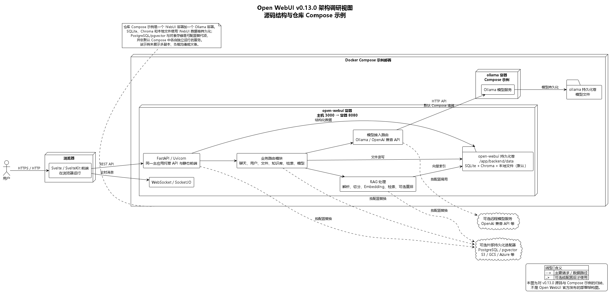

# 作业 4 · 架构调研分析：Open WebUI

> 状态：v0.2 调研参考稿（固定版本与核心源码事实已复核；组内复核通过，不单独提交）
> 调研对象：Open WebUI GitHub 仓库的公开源码
> 固定版本：`v0.13.0`
> commit：`c38885a1a737da4968f157092f304f3b5481d0bf`
> 调研时间：2026-11-04 至 2026-11-05
> 本地浅克隆：`D:\大三上\软件系统分析与设计\Open-WebUI-调研副本`
> 方法边界：固定 commit 的静态源码与仓库配置分析；本次未实际部署或运行系统。

## 1. 对象说明与证据边界

Open WebUI 是一个提供聊天、模型接入、知识库/RAG、工具扩展等能力的 AI 应用平台。仓库 README 将其描述为可自托管、可连接本地 Ollama 和 OpenAI 兼容模型的应用；本报告以 `v0.13.0` 对应的仓库源码、README、Dockerfile 和 Compose 文件为证据。

本报告分析的是该公开版本能观察到的代码结构与示例部署，不声称掌握 Open WebUI 团队生产环境的内部架构，也没有通过实际部署验证运行行为。源码中能直接确认的内容标为“源码事实”；“模块化单体”等架构风格是基于这些事实作出的分析判断。

**许可证事实**：该快照的 `LICENSE` 使用名称“Open WebUI License”，第 4 条对部署/分发时移除或更改 Open WebUI 品牌设有条件和例外（包括滚动 30 天内直接使用者不超过 50 人、取得书面许可或适用明确允许改品牌的企业许可）；许可证也说明部分旧材料可能适用历史许可。本报告据此称其为“GitHub 公开源码项目”，不对许可证作超出文本的法律结论，也不把它描述为使用 MIT、Apache-2.0 等常见标准许可证。助教已确认该案例可用于本次调研。

**调研结论摘要**：该快照可分析为“单一 Web 应用核心 + 可替换外部适配器”的模块化单体；仓库 Compose 示例将 WebUI 与 Ollama 分为两个容器，并通过命名卷保存应用数据和模型文件。其模块化、provider 适配和自托管选项带来扩展与部署灵活性，但共享应用进程、可选外部模型依赖和单机示例拓扑也意味着耦合、数据外发治理及高可用能力不能被忽略。以上是基于固定版本源码和配置的分析，不代表对生产部署或运行质量的实测结论。

## 2. 系统架构概览

源码呈现出“单一 Web 应用核心 + 可替换外部适配器”的形态：

1. 浏览器端是 Svelte/SvelteKit 与 TypeScript 构成的前端。Dockerfile 将前端构建为静态资源。
2. Python 后端由 FastAPI/Uvicorn 承载。主应用集中注册聊天、用户、文件、知识库、检索、模型接入等 API 路由，同时挂载 WebSocket/Socket.IO 和前端静态页面。
3. 对话和知识检索通过 provider/API 适配层连接 Ollama、OpenAI 兼容服务等模型服务。
4. 持久化在代码中分为关系数据、向量索引、原始文件等职责。普通配置下 SQLite、嵌入式 Chroma 和本地文件均可落在 WebUI 的数据目录；也可以配置 PostgreSQL、外部向量库或对象存储。图中可选项不代表默认 Compose 额外启动了这些服务。

据“一个 FastAPI 应用内集中注册多个业务路由、同一运行单元服务前端与 API”的实现特征，可将它分析为**模块化单体（modular monolith）**，而不是把每个功能路由都解释成一个独立微服务。项目本身未在本报告所依据的材料中将自身正式命名为该架构风格。

可编辑源文件：[`架构视图-OpenWebUI-v0.1.puml`](架构视图-OpenWebUI-v0.1.puml)

## 3. 架构风格与模块职责

| 结构 | 可核实职责 | 架构分析 |
|---|---|---|
| Svelte 前端 | 提供聊天、知识库、管理和配置界面；编译输出由后端应用挂载 | 前后端在源代码组织上分开，在默认部署中不需要单独运行前端服务器 |
| FastAPI 主应用 | 创建应用生命周期、挂载静态页面和 WebSocket，并注册领域 API 路由 | 单一应用进程内按路由/包组织职责，属于模块化单体的证据 |
| 业务路由模块 | `chats`、`users`、`files`、`knowledge`、`retrieval`、`models` 等 | 以路由模块划分业务入口，模块仍共享同一应用配置与运行环境 |
| 模型接入层 | `/ollama`、`/openai` 代理路由及相应客户端配置 | 通过协议/服务适配提高模型兼容性；使用外部云模型时数据会离开本地边界 |
| 检索与 RAG | 文件/文本处理、切分、embedding、向量存储、相似度/混合检索与可选 reranker | 处理链可配置，但会引入模型、向量库和文件解析等额外依赖 |
| 关系数据层 | SQLAlchemy；默认 SQLite URL，可通过配置使用其他数据库 | 账户、对话、配置等结构化状态与向量索引分开管理 |
| 向量存储适配器 | 普通配置默认嵌入式 Chroma；Slim 默认 pgvector；代码还包含 Qdrant、Milvus、Weaviate 等适配器 | 以配置和工厂方式隔离多种向量存储实现 |
| 文件存储适配器 | 默认本地存储；代码支持 S3、GCS、Azure | 原文件/对象存储与关系元数据、向量索引是不同持久化职责 |

## 4. 关键业务流程：文件进入知识库并用于回答

根据 `routers/retrieval.py`、`retrieval/utils.py` 和向量库工厂，可归纳出以下流程：

1. 经鉴权的用户提交文件处理请求；后端读取文件或已存文本，并按配置调用解析器。
2. 文本按配置进行切分；源码可见 Markdown 标题、递归字符、token 等切分路径，并保留文档元数据。
3. 系统调用配置的 embedding provider 生成向量，分批写入配置的向量集合，随后更新文件处理状态。
4. 用户或模型工具发起知识查询时，代码先根据所有者、管理员身份或授权记录筛选可访问知识库，再执行查询。
5. 检索工具返回包含文本片段、来源和距离等信息的 JSON 结果，供聊天/工具编排继续使用。启用混合检索时可结合向量召回与 BM25，并可使用 reranker；不能据此断言每次聊天请求都会自动执行同一条 RAG 链路。

这体现出“先确定授权集合，再查询并返回来源片段”的实现路径，是访问控制的代码证据，不等于对整个系统安全性的完整审计。

## 5. 部署策略与技术选型

### 5.1 仓库给出的默认 Compose 示例

仓库根目录的 `docker-compose.yaml` 定义两个容器：

- `open-webui`：构建/运行 Web 应用，容器端口 `8080` 映射到主机 `3000`，使用命名卷 `open-webui` 持久化 `/app/backend/data`。
- `ollama`：单独运行本地模型服务，使用命名卷 `ollama` 保存模型；WebUI 通过 `OLLAMA_BASE_URL=http://ollama:11434` 访问它。
- 两个服务均设置 `restart: unless-stopped`。

这是便于本地自托管的部署示例。默认数据卷挂载到 `/app/backend/data`，应用默认 SQLite 数据库和嵌入式 Chroma 的数据目录均在该数据树中；默认本地文件存储也使用应用数据目录。该 Compose 文件没有展示负载均衡、多副本、跨节点存储、数据库备份或灾难恢复设计，因此不能单凭此示例推断生产部署形态。

### 5.2 技术栈和选择理由（基于仓库结构的分析）

| 技术/组件 | 版本或默认策略 | 作用与分析 |
|---|---|---|
| Svelte/SvelteKit、TypeScript、Vite | `package.json` 声明 SvelteKit 2、Svelte 5、Vite 5（版本范围以该快照清单为准） | 组件化构建浏览器 UI，构建产物由后端挂载 |
| Python、FastAPI、Uvicorn、Pydantic | `pyproject.toml` 固定版本 | 统一承载 HTTP API、鉴权依赖、请求校验和异步服务 |
| SQLAlchemy + SQLite | 默认数据库 URL 指向应用数据目录的 `webui.db` | 降低单机/试用部署门槛；部署规模或运维需求变化时可配置其他关系库 |
| Chroma / pgvector 等 | 普通配置默认 Chroma；Slim 配置默认 pgvector | 让向量检索存储可以按部署约束替换；Slim 下嵌入式 Chroma 不可用，使用 pgvector 时需配置外部 PostgreSQL |
| 本地文件存储 / 对象存储 | 默认 `local`；支持 S3、GCS、Azure | 小型自托管部署简单；集中化/云部署可切换对象存储 |
| Ollama / OpenAI 兼容 API | 可配置本地或远程 provider | 同一 WebUI 可连接不同模型服务，获得灵活性；远程 provider 有网络、费用和数据治理代价 |
| Docker 多阶段构建 | Node 前端构建阶段 + Python 运行阶段 | 统一封装前后端，简化部署；CUDA、Slim、内置 Ollama 等构建选项增加镜像组合和维护复杂度 |

## 6. 关键质量属性分析

以下“高/中”是本组根据源码与仓库部署示例作出的定性判断，不是项目方公布的测试评级。

| 质量属性 | 判断 | 证据与收益 | 代价、限制或待核实项 |
|---|---|---|---|
| 可部署性 | 较强 | README 同时给出 Python 与 Docker 入口；Compose 将 WebUI 和 Ollama 容器化，并以命名卷保存数据 | 多种镜像/build flags、数据库和存储组合增加配置与升级测试负担 |
| 可扩展性 | 较强 | FastAPI 路由模块、工具/函数/插件入口，以及向量存储工厂支持多种实现 | 大量模块仍位于同一应用进程，模块间配置和共享状态可能形成耦合 |
| 互操作性 | 较强 | 支持 Ollama 和 OpenAI 兼容接口，并提供多种向量库、对象存储适配器 | 兼容 API 不意味着各 provider 行为完全相同；需处理能力差异和错误语义 |
| 隐私/数据控制 | 有条件 | 自托管、可离线运行、可接本地模型，文件也可本地保存 | README 同时支持云端模型；自托管本身不保证提示词或文件内容不会发送给外部服务 |
| 可修改性 | 中等偏强 | 前端、后端和领域路由按模块组织，业务扩展点较多 | 单体共享进程使边界依赖应用级配置；当前项目规模庞大，改动影响面需通过测试控制 |
| 性能 | 有优化手段但需权衡 | 支持异步 API、并发检索、混合检索与可选 reranking | embedding、reranking、模型推理会消耗 CPU/GPU 和内存；额外精排会增加响应耗时 |
| 可用性/弹性 | 默认示例较弱 | Docker restart 策略、持久化卷有助于进程重启和状态保存；代码支持配置 Redis 会话及 WebSocket 跨实例协调 | 默认 Compose 是单个 WebUI 容器加一个 Ollama 容器，未给出高可用、负载均衡、备份恢复和故障切换配置；该 Compose 未配置 Redis，代码支持不等于示例已部署 Redis |
| 安全与访问控制 | 有实现证据，仍需专项审查 | 检索端对用户身份和集合访问做校验，应用包含认证、MFA、权限等模块 | 本次为架构调研而非安全审计；外部模型、工具插件、文件解析均扩大信任边界 |

## 7. 对后续系统架构设计阶段的启发

以下内容只是把案例观察转化为后续可复核的问题，不是当前已批准的“智能笔记助手”架构方案，也不属于本次架构调研提交中的系统设计结论：

1. 后续可将“模块化单体 + 清晰业务边界”作为候选之一，并依据 ASR 比较；不能因为 Open WebUI 采用该形态就直接照搬，也不因系统包含 AI 功能就默认采用微服务。
2. 后续评估模型适配边界时，应明确本地模型、远程模型和无模型降级各自的数据流向、授权条件与故障行为。
3. 后续设计需判断结构化业务状态、原始文档/笔记附件、向量索引是否分离，并定义删除、重建和版本变化时的一致性规则。
4. 后续检索设计需核实授权过滤是否先于检索、排序与证据返回；这是本项目需求需论证的约束，不是从案例直接推定的实现。
5. 后续部署方案应基于已确认的运行位置、用户规模和质量场景比较单实例、外部数据库/对象存储及多实例等选项，不预设具体产品。

## 8. 复核记录与提交前待办

- [x] 助教确认 Open WebUI 可作为本次案例。汇报时仍按准确口径说明其公开源码与自定义许可证。
- [x] 对部署质量属性避免过度推断；本报告将 Compose 定位为仓库示例拓扑，不代表生产部署拓扑。
- [x] 如汇报需要讨论多副本，再另查官方部署文档；当前报告不以 Redis 等配置入口推断生产形态。
- [x] 已记录自定义许可证和品牌条款，并以来源链接支持；未复制或再分发上游源码。
- [x] 组长确认架构调研不需要单独提交；本报告保留为系统架构设计参考。
- [x] 已对照仓库外固定版本副本核验报告中的 Compose、数据库/向量库默认值、许可条款及关键应用结构。
- [x] 已检查报告所列 GitHub 源码链接指向固定 commit；报告中的本地图片和 PlantUML 源文件均存在。
- [x] 组员已复核本报告；组长反馈未发现问题。
- [ ] 若系统架构设计汇报需要引用本案例，再压缩为设计背景说明；不把案例技术栈直接当作本项目选型。

## 9. 证据索引

所有 GitHub 链接固定到 commit `c38885a1a737da4968f157092f304f3b5481d0bf`，避免引用会变化的 `main`：

| 结论 | 仓库证据 |
|---|---|
| 版本、产品描述和前后端依赖声明 | [`README.md`](https://github.com/open-webui/open-webui/blob/c38885a1a737da4968f157092f304f3b5481d0bf/README.md)、[`package.json`](https://github.com/open-webui/open-webui/blob/c38885a1a737da4968f157092f304f3b5481d0bf/package.json#L1-L18)、[`pyproject.toml`](https://github.com/open-webui/open-webui/blob/c38885a1a737da4968f157092f304f3b5481d0bf/pyproject.toml#L1-L20) |
| 自定义许可与品牌条款 | [`LICENSE`](https://github.com/open-webui/open-webui/blob/c38885a1a737da4968f157092f304f3b5481d0bf/LICENSE#L1-L30)、[`LICENSE_HISTORY`](https://github.com/open-webui/open-webui/blob/c38885a1a737da4968f157092f304f3b5481d0bf/LICENSE_HISTORY) |
| FastAPI 应用创建、路由和前端托管 | [`backend/open_webui/main.py`](https://github.com/open-webui/open-webui/blob/c38885a1a737da4968f157092f304f3b5481d0bf/backend/open_webui/main.py#L556-L561)、[路由注册](https://github.com/open-webui/open-webui/blob/c38885a1a737da4968f157092f304f3b5481d0bf/backend/open_webui/main.py#L814-L861)、[静态前端挂载](https://github.com/open-webui/open-webui/blob/c38885a1a737da4968f157092f304f3b5481d0bf/backend/open_webui/main.py#L3118-L3172) |
| 默认应用数据库 | [`backend/open_webui/env.py`](https://github.com/open-webui/open-webui/blob/c38885a1a737da4968f157092f304f3b5481d0bf/backend/open_webui/env.py#L242-L291) |
| 向量库默认与持久化 | [`backend/open_webui/config.py`](https://github.com/open-webui/open-webui/blob/c38885a1a737da4968f157092f304f3b5481d0bf/backend/open_webui/config.py#L483-L503)、[`backend/open_webui/retrieval/vector/dbs/chroma.py`](https://github.com/open-webui/open-webui/blob/c38885a1a737da4968f157092f304f3b5481d0bf/backend/open_webui/retrieval/vector/dbs/chroma.py#L34-L63)、[`backend/open_webui/retrieval/vector/factory.py`](https://github.com/open-webui/open-webui/blob/c38885a1a737da4968f157092f304f3b5481d0bf/backend/open_webui/retrieval/vector/factory.py#L20-L102) |
| 文件存储默认与可选 provider | [`backend/open_webui/config.py`](https://github.com/open-webui/open-webui/blob/c38885a1a737da4968f157092f304f3b5481d0bf/backend/open_webui/config.py#L145-L160)、[`backend/open_webui/storage/provider.py`](https://github.com/open-webui/open-webui/blob/c38885a1a737da4968f157092f304f3b5481d0bf/backend/open_webui/storage/provider.py#L63-L106) |
| RAG 处理和检索 | [切分、embedding 与向量写入](https://github.com/open-webui/open-webui/blob/c38885a1a737da4968f157092f304f3b5481d0bf/backend/open_webui/routers/retrieval.py#L1406-L1625)、[文件处理与索引](https://github.com/open-webui/open-webui/blob/c38885a1a737da4968f157092f304f3b5481d0bf/backend/open_webui/routers/retrieval.py#L1641-L1840)、[集合查询与可选混合检索](https://github.com/open-webui/open-webui/blob/c38885a1a737da4968f157092f304f3b5481d0bf/backend/open_webui/routers/retrieval.py#L2860-L2945)、[知识工具的授权过滤与结果组装](https://github.com/open-webui/open-webui/blob/c38885a1a737da4968f157092f304f3b5481d0bf/backend/open_webui/tools/builtin.py#L3307-L3523)、[`backend/open_webui/retrieval/utils.py`](https://github.com/open-webui/open-webui/blob/c38885a1a737da4968f157092f304f3b5481d0bf/backend/open_webui/retrieval/utils.py#L683-L875) |
| 可选 Redis 会话与 Socket.IO 协调 | [`backend/open_webui/main.py`](https://github.com/open-webui/open-webui/blob/c38885a1a737da4968f157092f304f3b5481d0bf/backend/open_webui/main.py#L2737-L2745)、[`backend/open_webui/socket/main.py`](https://github.com/open-webui/open-webui/blob/c38885a1a737da4968f157092f304f3b5481d0bf/backend/open_webui/socket/main.py#L119-L120)、[`backend/open_webui/env.py`](https://github.com/open-webui/open-webui/blob/c38885a1a737da4968f157092f304f3b5481d0bf/backend/open_webui/env.py#L369-L369) |
| Docker 双服务示例 | [`docker-compose.yaml`](https://github.com/open-webui/open-webui/blob/c38885a1a737da4968f157092f304f3b5481d0bf/docker-compose.yaml)、[`Dockerfile`](https://github.com/open-webui/open-webui/blob/c38885a1a737da4968f157092f304f3b5481d0bf/Dockerfile) |

本地复核优先查看上述文件；上游源码浅克隆放在项目仓库之外：`D:\大三上\软件系统分析与设计\Open-WebUI-调研副本`。大作业仓库仅保留版本与 commit、分析和必要的架构图，不内嵌上游源码副本。
